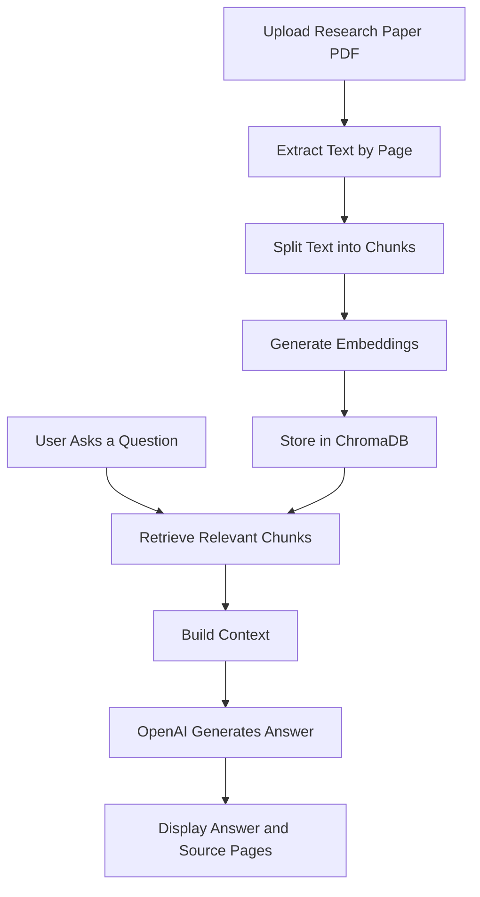

# 📚 AI Research Paper Assistant — RAG-Powered Research Companion

<p align="center">
  <b>Ask questions. Understand research papers. Get answers grounded in the source.</b>
</p>

<p align="center">
  
  
  
  
  
</p>

## 🌟 Overview

Reading and understanding lengthy research papers can be time-consuming. **AI Research Paper Assistant** is a Retrieval-Augmented Generation (RAG) application designed to make academic research easier and more interactive.

Upload a research paper in PDF format, ask questions in natural language, and receive AI-generated answers based on relevant passages retrieved from the document.

Instead of relying only on a language model's general knowledge, the application retrieves relevant document chunks and uses them as context to generate more grounded responses.

## ✨ Key Features

- 📄 **PDF Upload:** Upload research papers up to the configured file-size limit.
- 🧠 **AI-Powered Question Answering:** Ask questions about a paper using natural language.
- 🔎 **Semantic Search:** Find relevant passages using sentence embeddings and vector similarity.
- 🧩 **Intelligent Chunking:** Split extracted document text into smaller, overlapping chunks.
- 📌 **Source References:** Display retrieved passages with page references when available.
- ⚡ **Context-Aware Responses:** Generate answers using the retrieved content as context.
- 🖥️ **Interactive Interface:** Explore papers through a simple Streamlit web application.
- 🔐 **Environment-Based Configuration:** Keep API credentials outside the source code.

## 🛠️ Tech Stack

| Technology | Purpose |
|---|---|
| 🐍 Python | Core application logic |
| 🎈 Streamlit | Interactive web interface |
| 📑 PyPDF | PDF text extraction |
| 🤖 Sentence Transformers | Text embeddings |
| 🗄️ ChromaDB | Vector storage and similarity search |
| ✨ OpenAI API | Context-aware answer generation |
| 🧪 Pytest | Unit testing |
| 🔑 python-dotenv | Environment variable management |

## 🏗️ How It Works

The application follows a Retrieval-Augmented Generation (RAG) workflow.



### 🔬 RAG Pipeline Explained

1. **Document ingestion:** Extract text from the uploaded PDF while retaining page information.
2. **Text chunking:** Divide the extracted text into smaller chunks with configurable overlap.
3. **Embedding generation:** Convert text chunks into numerical vector representations.
4. **Vector indexing:** Store embeddings and associated metadata in ChromaDB.
5. **Semantic retrieval:** Retrieve the most relevant chunks for the user's question.
6. **Answer generation:** Pass the question and retrieved context to the language model.
7. **Source presentation:** Display the answer alongside relevant passages and page references.

## 🖼️ Application Preview

> 📸 Add genuine screenshots of your running application here after deployment.

<!-- Replace these placeholders with actual screenshots committed to your repository. -->

<!--  -->

<!--  -->

<!--  -->

## 📂 Project Structure

```text
ai-research-paper-assistant/
│
├── app.py                       # Streamlit application
├── rag_pipeline.py              # Retrieval and answer generation
├── document_processor.py         # PDF extraction and chunking
├── config.py                     # Configuration and environment variables
├── requirements.txt              # Python dependencies
├── .env.example                 # Example environment variables
├── .gitignore                    # Files excluded from Git
├── README.md                     # Project documentation
│
└── tests/
    ├── test_document_processor.py
    └── test_rag_pipeline.py
```

## 🚀 Getting Started

### 1️⃣ Clone the Repository

```bash
git clone https://github.com/kanishak2004/ai-research-paper-assistant.git
cd ai-research-paper-assistant
```

### 2️⃣ Create a Virtual Environment

```bash
python -m venv .venv
```

Activate it:

**macOS / Linux**
```bash
source .venv/bin/activate
```

**Windows**
```bash
.venv\Scripts\activate
```

### 3️⃣ Install Dependencies

```bash
pip install -r requirements.txt
```

### 4️⃣ Configure the OpenAI API Key

Create a `.env` file in the project root using `.env.example` as a template.

```env
OPENAI_API_KEY=your_api_key_here
OPENAI_MODEL=gpt-4o-mini
```

🔐 **Security note:** Never commit your real API key to GitHub. Keep `.env` private and use your deployment platform's secrets manager for hosted applications.

### 5️⃣ Run the Application

```bash
streamlit run app.py
```

Open the local URL displayed in your terminal to access the application.

## ☁️ Deployment

The application can be deployed using [Streamlit Community Cloud](https://streamlit.io/cloud).

1. Push the project files to a GitHub repository.
2. Connect your GitHub account to Streamlit Community Cloud.
3. Select the repository and choose `app.py` as the entry point.
4. Add `OPENAI_API_KEY` and `OPENAI_MODEL` in the app's secrets settings.
5. Deploy and test the application with a sample research paper.

📌 The application needs a valid API key to generate answers. Initial deployment may take longer while dependencies and the embedding model are installed.

## 🧪 Testing

Run the test suite with:

```bash
pytest -q
```

The test files cover document-processing behavior and selected RAG pipeline safeguards.

> ✅ Run the tests in a configured Python environment before describing the project as fully tested.

## ⚙️ Configuration

The application supports configurable settings, including:

| Setting | Purpose |
|---|---|
| `OPENAI_API_KEY` | API authentication |
| `OPENAI_MODEL` | Language model used for answers |
| `EMBEDDING_MODEL` | Sentence embedding model |
| `CHUNK_SIZE` | Maximum target chunk length |
| `CHUNK_OVERLAP` | Overlap between consecutive chunks |
| `TOP_K` | Number of relevant chunks retrieved |
| `MAX_FILE_SIZE_MB` | Maximum accepted PDF size |

Default values are defined in `config.py`.

## 🔮 Future Improvements

- 📚 Support multiple research papers in one session.
- 💬 Maintain conversation history for follow-up questions.
- 📊 Add document summaries and key-point extraction.
- 📑 Export answers and citations into downloadable reports.
- 🔍 Improve source citation formatting and retrieval evaluation.
- 🧪 Add end-to-end tests for document upload and question answering.
- 🚀 Optimize model loading and deployment performance.

## 🎯 What This Project Demonstrates

- Retrieval-Augmented Generation (RAG) fundamentals
- PDF processing and document chunking
- Semantic search and vector databases
- Embedding-based information retrieval
- LLM integration and context construction
- API key management and environment configuration
- Modular Python application design
- Unit testing and deployment preparation

## 👨‍💻 Author

**Kanishak Thakur**

💼 Aspiring AI/ML Engineer | Software Developer

🔗 [GitHub Profile](https://github.com/kanishak2004)

---

<p align="center">
  ⭐ If you find this project interesting, consider giving the repository a star!
</p>

<p align="center">
  <i>Making research papers easier to explore, one question at a time. 🚀</i>
</p>
